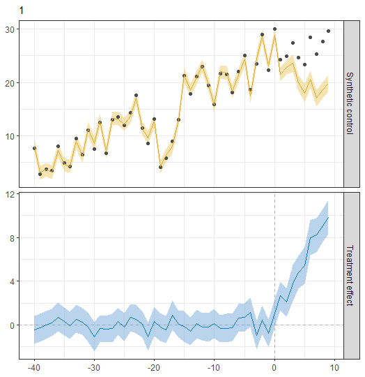

# bscm: Bayesian Synthetic Control Models

<!-- badges: start -->
[](https://www.repostatus.org/#active)
[](https://github.com/helske/bscm/actions/workflows/R-CMD-check.yaml)
[](https://app.codecov.io/gh/helske/bscm)
[](https://CRAN.R-project.org/package=bscm)
<!-- badges: end -->

R package for Bayesian Synthetic Control Models (Helske 2026, in-preparation). 

Key features:
* Time-varying covariates, optionally with time-varying coefficients as splines.
* Multiple treated units, with or without staggered adoption.
* Weakly informative default priors and user-defined priors are supported.
* Computationally and statistically efficient posterior sampling via 
  pre-compiled [Stan](https://mc-stan.org/) models.
* Convenient methods for extracting posterior summaries or draws of 
  treatment effects, synthetic control series, donor weights, RMSE, 
  Bayesian R^2, and other quantities of interest.
* Model evaluation and comparison using leave-one-out and leave-future-out 
  cross-validation, leave-donor(s)-out, in-time and in-space placebos.


## Installation

You can install the development version of `bscm` as

``` r
remotes::install_github("helske/bscm")
```

## Example

``` r
library(bscm)
set.seed(3546)
fit <- bscm(
    y ~ x, data = single_treated, 
    treatment = "treatment", time = "time", unit = "id",
    chains = 2, refresh = 0
)
```
Basic summary of the estimated model:
``` r
Call:
bscm(formula = y ~ x, data = single_treated, treatment = "treatment", 
    time = "time", unit = "id", chains = 2, refresh = 0)

Bayesian synthetic control model y ~ x  
Treated unit: 1 
Number of donors: 50 
Number of time periods (pre + post): 40 + 10 
MCMC sampling using 2 chains with 2500 + 2500 iterations took 18.63 seconds

MCMC diagnostics indicate no issues. 

Coefficients:
  variable   mean     sd   q2.5 q97.5  rhat ess_bulk ess_tail mcse_mean
1 intercept 0.461 0.457  -0.412  1.40 1.000    4306.    4061.   0.00694
2 x         0.935 0.0848  0.769  1.10 1.00     4894.    3982.   0.00121

Error:
  variable  mean     sd  q2.5 q97.5  rhat ess_bulk ess_tail mcse_mean
1 sigma    0.592 0.0749 0.467 0.760  1.00    3707.    4336.   0.00122

Donor weights:
  variable                    mean    sd  q2.5 q97.5  rhat ess_bulk ess_tail mcse_mean
1 Effective number of donors  4.90  1.53  2.47  8.46  1.00    3933.    3886.    0.0241

Average treatment effects and measures of model fit:
  variable                           mean      sd   q2.5 q97.5  rhat ess_bulk ess_tail mcse_mean
1 Average pre-treatment effect  -0.000354 0.134   -0.262 0.268  1.00    7274.    4633. 0.00158  
2 Average post-treatment effect  5.50     0.438    4.66  6.37   1.00    4731.    4598. 0.00639  
3 Bayesian R2                    0.993    0.00180  0.989 0.996  1.00    3691.    4476. 0.0000292
4 Pre-treatment RMSE             0.823    0.105    0.638 1.05   1.00    3738.    4351. 0.00172  
5 Post-treatment RMSE            6.28     0.449    5.43  7.15   1.00    4480.    4491. 0.00673
```
And default visualization:
``` r
plot(fit)
```

