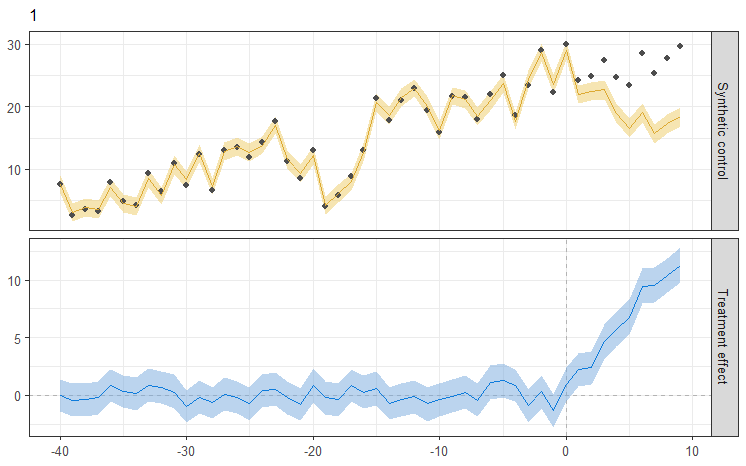

# bscm: Bayesian Synthetic Control Models

<!-- badges: start -->
[](https://www.repostatus.org/#active)
[](https://github.com/helske/bscm/actions/workflows/R-CMD-check.yaml)
[](https://app.codecov.io/gh/helske/bscm)
[](https://CRAN.R-project.org/package=bscm)
<!-- badges: end -->

R package for Bayesian Synthetic Control Models (Helske 2026, in-preparation). 

Key features:
* Time-varying covariates, optionally with time-varying coefficients as splines.
* Multiple treated units, with or without staggered adoption.
* Weakly informative default priors and user-defined priors are supported.
* Computationally and statistically efficient posterior sampling via 
  pre-compiled [Stan](https://mc-stan.org/) models.
* Convenient methods for extracting posterior summaries or draws of 
  treatment effects, synthetic control series, donor weights, RMSE, 
  Bayesian R^2, and other quantities of interest.
* Model evaluation and comparison using leave-one-out and leave-future-out 
  cross-validation, leave-donor(s)-out, in-time and in-space placebos.


## Installation

You can install the development version of `bscm` as

``` r
remotes::install_github("helske/bscm")
```

## Example

``` r
library(bscm)
set.seed(3546)
fit <- bscm(
    y ~ x, data = single_treated, 
    treatment = "treatment",  time = "time",  unit = "id",
    chains = 2, refresh = 0
)
```
Basic summary of the estimated model:
``` r
Call:
bscm(formula = y ~ x, data = single_treated, treatment = "treatment", 
    time = "time", unit = "id", chains = 2, refresh = 0)

Bayesian synthetic control model y ~ x  
Treated unit: 1 
Number of donors: 50 
Number of time periods (pre + post): 40 + 10 
MCMC sampling using 2 chains with 2500 + 2500 iterations took 7.73 seconds

MCMC diagnostics indicate no issues. 

Summary statistics of the time-invariant parameters:
  variable        mean     sd   q2.5 q97.5
1 Intercept     0.0910 0.437  -0.646 1.06 
2 coef_x        0.982  0.0606  0.856 1.10 
3 concentration 0.199  0.0663  0.106 0.355
4 Residual SD   0.593  0.0779  0.461 0.765

Average treatment effects and measures of model fit:
  variable                           mean      sd   q2.5 q97.5
1 Average pre-treatment effect  -0.000720 0.135   -0.265 0.262
2 Average post-treatment effect  5.90     0.319    5.24  6.52 
3 Bayesian R2                    0.993    0.00187  0.989 0.996
4 Pre-treatment RMSE             0.824    0.108    0.639 1.05 
5 Post-treatment RMSE            6.75     0.331    6.08  7.42 
```
And default visualization:
``` r
plot(fit)
```

